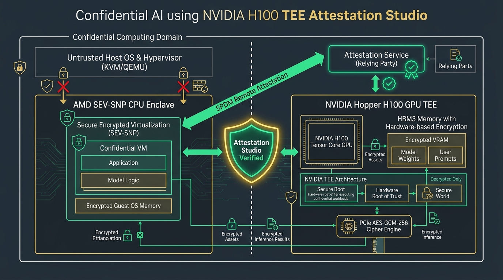

# Confidential AI & NVIDIA H100 TEE Attestation Studio

[](https://github.com/Pradeeptalari14/tp-confidential-ai-tee/actions)
[](LICENSE)
[](https://talaripradeep.info)

Production-grade implementation of **Hardware-Attested Confidential AI** leveraging NVIDIA Hopper H100 GPU TEE (Trusted Execution Environment), AMD SEV-SNP enclave isolation, and SPDM remote attestation.



## Key Technical Highlights
- **Untrusted Hypervisor Lockdown:** Completely prevents host root users, compromised hypervisors, and cloud provider administrators from reading model weights or user prompts.
- **NVIDIA Hopper GPU TEE:** Hardware AES-GCM-256 cipher engines encrypt all data crossing PCIe buses and residing in HBM3 VRAM.
- **SPDM Remote Attestation:** Cryptographically validates hardware measurements, firmware hashes, and DICE certificate chains against NVIDIA/AMD Root of Trust.
- **Sub-2.5% Performance Overhead:** Delivers enterprise confidential computing security with minimal throughput penalty.

## Quickstart
```bash
git clone https://github.com/Pradeeptalari14/tp-confidential-ai-tee.git
cd tp-confidential-ai-tee
bash scripts/validate.sh
```
